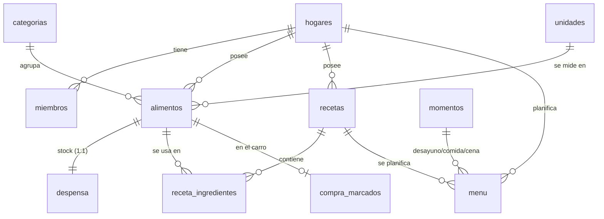

# 🍽️ Menú Semanal

Aplicación móvil para planificar menús, llevar el inventario de la despensa y generar
automáticamente la lista de la compra. **Varias personas comparten los mismos datos** en tiempo real.

Es una **PWA** (Progressive Web App) hecha con HTML, CSS y JavaScript sin frameworks. Los datos
viven en **PostgreSQL** (alojado en [Supabase](https://supabase.com)), protegidos con reglas de
seguridad a nivel de fila.

🔗 **App:** <https://mavtarq.github.io/MyMenuSemanal/>

## Funcionalidades

| Pantalla | Qué hace |
|---|---|
| 📅 **Menú** | Semana de lunes a domingo con desayuno, comida y cena. Al marcar un plato como *cocinado*, sus ingredientes se descuentan de la despensa. |
| 🍲 **Recetas** | Cada receta tiene sus raciones base y sus ingredientes con cantidades. |
| 🥫 **Despensa** | Lo que hay en casa, por categorías. Botones − / + y un *stock mínimo* opcional. |
| 🛒 **Compra** | Lista calculada para un rango de fechas. Lo que se marca en el súper aparece al momento en el móvil del otro, y con un botón pasa a la despensa. |
| ⚙️ **Ajustes** | Código de invitación del hogar, miembros, copia de seguridad (JSON) e importación de la versión anterior (`.sqlite`). |

### Cómo se calcula la lista de la compra

```
necesario  = Σ (cantidad del ingrediente × raciones planificadas / raciones de la receta)
             solo de los platos NO cocinados dentro del rango de fechas
a_comprar  = necesario + stock_mínimo − cantidad en la despensa      (si es > 0)
```

Las unidades enteras (`ud`, `paq`) se redondean hacia arriba.

## Arquitectura

```
 Móvil A ─┐                       ┌──────────── Supabase ────────────┐
          ├── HTTPS + sesión ───► │  Auth (correo y contraseña)      │
 Móvil B ─┘   ◄── tiempo real ─── │  PostgreSQL + reglas RLS         │
                                  │  Funciones SQL (lista_compra...) │
   App estática en GitHub Pages   └──────────────────────────────────┘
```

- Cada familia es un **hogar**. Quien lo crea recibe un **código de invitación**, y el resto se une con él.
- Las **reglas RLS** (Row Level Security) hacen que un usuario solo pueda leer y modificar filas de su hogar.
  La protección está en la base de datos, no en la app: aunque alguien manipule el JavaScript, no puede ver datos ajenos.
- Las operaciones de varios pasos (guardar una receta con sus ingredientes, cocinar, registrar la compra)
  son **funciones SQL** que se ejecutan en una sola transacción.
- **Sin conexión**: la app se abre y muestra los últimos datos consultados, pero para modificar hace falta conexión.

### Estructura del proyecto

```
├── index.html               Pantallas y diálogos
├── css/estilos.css          Estilos (móvil primero, modo oscuro automático)
├── js/
│   ├── app.js               Interfaz: pinta pantallas y responde a los toques
│   ├── modelo.js            TODAS las operaciones con la base de datos
│   ├── db.js                Conexión con Supabase, caché sin conexión y errores
│   ├── config.js            URL y clave pública del proyecto Supabase
│   └── migracion.js         Lee la base de datos SQLite de la versión anterior
├── supabase/esquema.sql     Tablas, relaciones, reglas RLS y funciones (PostgreSQL)
├── sw.js                    Service worker (modo sin conexión)
├── manifest.webmanifest     Datos para instalar la app
├── icons/                   Iconos (generados con herramientas/generar_iconos.py)
└── vendor/                  supabase-js 2.117.2 y sql.js 1.10.3 (solo para migrar)
```

## Base de datos



Conceptos de SQL que aparecen en [`supabase/esquema.sql`](supabase/esquema.sql):

- **Claves foráneas** con `ON DELETE CASCADE`, `SET NULL` y `RESTRICT`.
- **Relación N:M** (`receta_ingredientes`) con clave primaria compuesta.
- **Índices únicos por expresión**: `(hogar_id, lower(nombre))`, para no repetir nombres dentro de un hogar.
- **Row Level Security** con políticas por tabla.
- **Funciones** `security invoker` (respetan RLS) y `security definer` (para crear hogares o unirse a uno).
- **Trigger**: al crear un alimento se crea su fila en `despensa`.
- **Vistas** con `security_invoker`, **CTE**, agregación y `jsonb` (copias de seguridad).

## Puesta en marcha (una sola vez)

1. **Esquema**: en Supabase, abre *SQL Editor* → *New query* → pega [`supabase/esquema.sql`](supabase/esquema.sql) → *Run*.
   Puedes volver a ejecutarlo sin perder datos.
2. **URL de la app**: en *Authentication* → *URL Configuration*:
   - *Site URL*: `https://mavtarq.github.io/MyMenuSemanal/`
   - *Redirect URLs*: añade esa misma URL y `http://localhost:8000/` (para pruebas en el ordenador).

   Sin esto, los enlaces de los correos de confirmación llevarían a una dirección que no existe.
3. **Primer uso**: crea tu cuenta en la app, confirma el correo y crea un hogar. En *Ajustes* verás el código de
   invitación para compartirlo.

## Ejecutarla en el ordenador

```bash
python -m http.server 8000
```

Después abre <http://localhost:8000>. Usa la misma base de datos de Supabase que la versión publicada.

> El service worker guarda la app en caché. Cuando cambies el código, recarga dos veces o marca
> *Disable cache* en la pestaña *Network* de las herramientas de desarrollo (F12).

## Publicar cambios

1. Si añades o renombras ficheros, actualiza `ARCHIVOS` en `sw.js`.
2. Sube la versión de `CACHE` en `sw.js` (`menu-semanal-v3`, …).
3. `git commit` + `git push`. GitHub Pages se actualiza en uno o dos minutos, y los móviles cogen la versión nueva al abrir la app por segunda vez.

Si cambias el esquema, añade los cambios a `supabase/esquema.sql` de forma que se puedan repetir
(`create ... if not exists`, `alter table ... add column if not exists`, `create or replace function`)
y vuelve a ejecutarlo en el SQL Editor.

## Seguridad

- `js/config.js` contiene la clave **publishable**, que está pensada para ser pública. **Nunca** pongas la clave *secret* / *service_role* en el código.
- Sin sesión iniciada no se puede leer ni llamar a nada (se revocan los permisos de `anon`).
- Las copias de seguridad `.json` / `.sqlite` contienen tus datos: `.gitignore` evita subirlas a GitHub.
