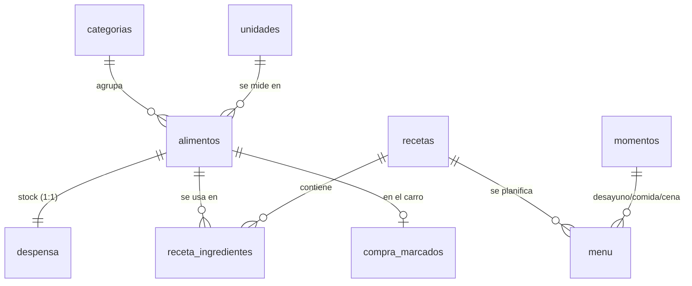

# 🍽️ Menú Semanal

Aplicación móvil para planificar menús, llevar el inventario de la despensa y generar
automáticamente la lista de la compra.

Es una **PWA** (Progressive Web App): HTML, CSS y JavaScript sin frameworks, con una base
de datos **SQLite real** que funciona dentro del móvil. Se instala desde el navegador como
cualquier app, funciona sin conexión y los datos no salen nunca del dispositivo.

## Funcionalidades

| Pantalla | Qué hace |
|---|---|
| 📅 **Menú** | Semana de lunes a domingo con desayuno, comida y cena. Añades recetas con sus raciones. Al marcar un plato como *cocinado*, sus ingredientes se descuentan de la despensa. |
| 🍲 **Recetas** | Cada receta tiene sus raciones base y sus ingredientes con cantidades. |
| 🥫 **Despensa** | Lo que tienes en casa, agrupado por categoría. Botones − / + para ajustar rápido y un *stock mínimo* opcional. |
| 🛒 **Compra** | Lista calculada para un rango de fechas. La marcas mientras compras y, con un botón, todo lo marcado pasa a la despensa. Se puede compartir por WhatsApp, etc. |
| ⚙️ **Ajustes** | Exportar o importar la base de datos (`.sqlite`), consola SQL y reinicio. |

### Cómo se calcula la lista de la compra

```
necesario  = Σ (cantidad del ingrediente × raciones planificadas / raciones de la receta)
             solo de los platos NO cocinados dentro del rango de fechas
a_comprar  = necesario + stock_mínimo − cantidad en la despensa      (si es > 0)
```

Las unidades enteras (`ud`, `paq`) se redondean hacia arriba.

## Estructura del proyecto

```
├── index.html               Pantallas y diálogos
├── css/estilos.css          Estilos (móvil primero, modo oscuro automático)
├── js/
│   ├── app.js               Interfaz: pinta pantallas y responde a los toques
│   ├── modelo.js            TODAS las consultas SQL de la app
│   └── db.js                Conexión con SQLite, transacciones y guardado
├── sql/
│   ├── schema.sql           Tablas, relaciones, trigger y vista
│   └── datos_iniciales.sql  Categorías, unidades y momentos del día
├── sw.js                    Service worker (modo sin conexión)
├── manifest.webmanifest     Datos para instalar la app
├── icons/                   Iconos (generados por código)
├── herramientas/generar_iconos.py
└── vendor/sql-wasm.*        SQLite compilado a WebAssembly (sql.js 1.10.3)
```

Las capas están separadas: `app.js` nunca escribe SQL, solo llama a funciones de `modelo.js`.

## Base de datos



Conceptos de SQL que aparecen en el proyecto:

- **Claves foráneas** con `ON DELETE CASCADE`, `SET NULL` y `RESTRICT` (no puedes borrar un alimento que se usa en una receta).
- **Relación N:M** (`receta_ingredientes`) con clave primaria compuesta.
- **Restricciones `CHECK`** (cantidades ≥ 0, fechas válidas).
- **Trigger**: al crear un alimento se crea su fila en `despensa`.
- **Vista** `v_despensa`, que une 4 tablas.
- **CTE** (`WITH ...`) y agregación en la consulta de la lista de la compra.
- **UPSERT** (`ON CONFLICT ... DO UPDATE`).
- **Transacciones**: cada operación se aplica entera o no se aplica.
- **Migraciones** con `PRAGMA user_version` (ver `prepararEsquema()` en `db.js`).

La consola SQL de *Ajustes* te deja hacer consultas sobre tus propios datos desde el móvil.

### Dónde se guardan los datos

sql.js mantiene la base de datos en memoria. Después de cada cambio, `db.js` exporta el
fichero `.sqlite` completo y lo guarda en **IndexedDB** (el almacenamiento del navegador).
Si borras los datos del navegador o desinstalas la app, se pierden. Por eso conviene
**exportar una copia de vez en cuando** desde Ajustes.

## Ejecutarla en el ordenador

El navegador no permite cargar `.wasm` ni `.sql` abriendo `index.html` con doble clic, así
que hace falta un servidor local. Python ya trae uno:

```bash
python -m http.server 8000
```

Después abre <http://localhost:8000>. Activa la vista de móvil del navegador con `F12` → icono
de móvil.

> El service worker guarda la app en caché. Cuando cambies el código, recarga dos veces o
> marca *Disable cache* en la pestaña *Network* de las herramientas de desarrollo.

## Instalarla en el móvil

Para instalarse, una PWA tiene que servirse por **HTTPS**. Lo más sencillo es GitHub Pages (gratis):

1. Crea un repositorio en GitHub y sube esta carpeta:
   ```bash
   git init
   git add .
   git commit -m "Primera versión de Menú Semanal"
   git branch -M main
   git remote add origin https://github.com/TU_USUARIO/menu-semanal.git
   git push -u origin main
   ```
2. En GitHub ve a **Settings → Pages → Branch: `main` / root → Save**.
3. Al cabo de un minuto estará en `https://TU_USUARIO.github.io/menu-semanal/`.
4. Ábrela en el móvil:
   - **Android (Chrome)**: menú ⋮ → *Instalar aplicación*.
   - **iPhone (Safari)**: botón compartir → *Añadir a pantalla de inicio*.

La app queda con su icono y funciona sin conexión. Tus datos se quedan en el móvil, no en GitHub.

### Publicar cambios

1. Si has añadido o renombrado ficheros, añádelos a `ARCHIVOS` en `sw.js`.
2. Sube la versión en `sw.js`: `const CACHE = 'menu-semanal-v2';`
3. `git commit` + `git push`. El móvil se actualiza la siguiente vez que abras la app con conexión.

### Cambiar el esquema de la base de datos

Las tablas usan `CREATE TABLE IF NOT EXISTS`, así que **modificar una tabla en `schema.sql` no
cambia las bases de datos que ya existen**. Para eso:

1. Sube `VERSION_ESQUEMA` en `db.js` (por ejemplo, a 2).
2. Añade la migración en `prepararEsquema()`:
   ```js
   if (versionEsquema() < 2) db.exec('ALTER TABLE recetas ADD COLUMN tiempo_min INTEGER');
   ```
3. Pon también la columna en `schema.sql`, para que las instalaciones nuevas la tengan desde el principio.

## Ideas para seguir

- Editar categorías, unidades y momentos desde la app.
- Copiar el menú de la semana anterior.
- Caducidad de los alimentos (columna `caduca` en `despensa`).
- Conversión entre unidades (g ↔ kg).
- Fotos de las recetas (BLOB en SQLite).
